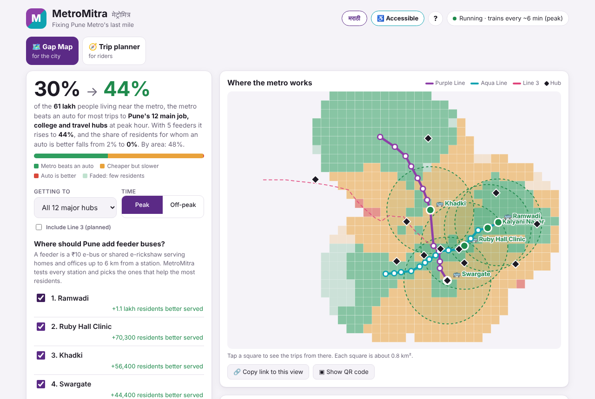

# MetroMitra · मेट्रोमित्र

**Fixing Pune Metro's last mile.** A Gap Map that shows where the metro beats an auto and where it fails, a simulator that finds the feeder buses that would fix it, and a door-to-door trip planner for riders.

Built for the Pune Metro hackathon · theme **Urban mobility**.

### ▶ [Live demo: blop77.github.io/metro-mitra](https://blop77.github.io/metro-mitra/)

   

[](https://blop77.github.io/metro-mitra/)

## The problem

Pune has two open metro lines, but for most trips people still take an auto. The train isn't the problem. **The first and last mile is.** If your home or office is 3–5 km from a station, the auto to and from the station costs more time and money than the metro saves.

Nobody can see where this happens. Ridership numbers say *how many* people use a station, not *who can't*.

## What MetroMitra does

### 🗺️ Gap Map (for the city: Maha-Metro, PMC, PMPML)

- **Splits Pune into ~0.9 km squares.** For every square and each of 12 major hubs (Hinjewadi, Kharadi, Magarpatta, Bhosari MIDC, the railway station, Swargate, the airport, Camp, Fergusson, SPPU, COEP, MIT-WPU), it plans the trip door to door and compares it with an auto.
- **Colours each square:** green where the metro beats an auto, amber where it's cheaper but slower, red where an auto is simply better.
- **Gives one headline number:** *"At peak hour, the metro beats an auto from 37% of Pune's area near the metro."*
- **Simulates feeders** (₹10 e-bus or shared e-rickshaw from a station, up to 6 km). It tests a feeder at every station and greedily picks the five that improve access the most: **37% → 53%**.
- **Lets you place feeders yourself:** tap any station to add or remove one and the map updates instantly.
- **City report:** ranks all 12 hubs by metro access, with the single best feeder for each. Print it or save it as a PDF to hand to decision-makers.
- **Pitch sheet:** a one-page English/Marathi opening slide with a live-rendered Gap Map, feeder gains, hub findings and QR code. Open [`pitch.html`](pitch.html) to present it or print it as a single A4 page.
- **Tap any square** to see every trip from there (route, time and cost vs an auto), then open it in the trip planner.
- **Share any view:** the destination, peak/off-peak, Line 3, chosen feeders and language live in the link. Copy it, or show a **QR code** on stage so judges open your exact view on their phones. Trips in the planner have a QR code too.
- **Quick guide:** a 5-step tour on the first visit (pick a destination → add feeders → tap a square → city report → trip planner), replayable from the **?** button.

What the model finds (peak hour; official fares, timetable and auto tariff, road model calibrated on real trips):

| Finding | Number |
|---|---|
| Worst-served hub | **Hinjewadi**: the metro wins from only 23% of the area; the planned Line 3 scenario raises it to **54%** |
| Best-served hubs | **Pune Railway Station** and **COEP**: 77% |
| Best single feeder for the city | **Ramwadi**: serves Kharadi, Viman Nagar and the airport |
| One feeder at Kalyani Nagar, for the Airport | Area where an auto is better: 26% → 11% |
| Opening Range Hill station (built, not yet open) | Metro wins for SPPU trips: 26% → 42%; city-wide: 37% → 42% |
| Five suggested feeders | Area where the metro wins: **37% → 53%** |

### 🌐 English / मराठी

The whole app (both tabs, the city report, errors and units) switches to Marathi with one tap, and remembers the choice. Station, landmark and line names switch too, and you can search in either language. Browsers set to Marathi start in Marathi. *The Marathi was written for the hackathon. Please have a native speaker review `js/i18n.js` and the names in `js/data.js`.*

### 🚈 Line 3 (planned)

The Gap Map can include the planned Hinjewadi–Shivajinagar Line 3 as a scenario. At peak hour, the area where the metro beats an auto for trips to Hinjewadi Phase 1 rises from **23% to 54%** in this model. Line 3's 45-minute end-to-end time is an estimate; the station list and coordinates are unverified estimates that should be checked on a map. PMRDA's fare is modeled with the existing slabs and may differ from the final fare.

### 🧭 Trip planner (for riders)

- Plan from a station, a landmark, a Marathi name (स्वारगेट) or 📍 GPS
- Door-to-door timeline with clock times: first mile → right line and direction → change at District Court → last mile
- Total cost including first and last mile, and an **honest verdict**: it says *take an auto* when the metro doesn't pay off
- Metro vs auto vs cab: time, ₹, CO₂
- Concession fares: student 30% off; Pune card / e-ticket 10% off on weekdays, 30% on weekends
- **Accessible mode:** larger controls and a step-free routing option with slower walking and extra station time; lift data are unverified placeholders until checked against Maha-Metro accessibility information
- Live service status, interactive network map, shareable trip links
- **My metro savings:** log the trips you take; see ₹ and CO₂ saved this month
- **Shareable savings card:** create a 1080×1080 English or Marathi PNG with this month's totals, ready to share or download
- **Works offline** (installable PWA), even underground with no signal

## How it works

```
js/data.js       Network (50 stations, 3 lines including planned Line 3), Marathi names, landmarks, 12 hubs, every tunable number
js/i18n.js       Every user-visible string in English and Marathi; t(key, vars)
js/planner.js    Trip engine: Dijkstra routing, fares, concessions, first/last mile, verdict (no DOM)
js/savings.js    Month filtering and trip totals for My metro savings (no DOM)
js/gapmap.js     Gap Map engine: grid, scoring, feeder simulation, greedy recommendations (no DOM)
js/app.js        Trip planner UI, tabs, savings tracker, share links
js/savings-card.js Draws and exports the shareable 1080×1080 savings card
js/gap-ui.js     Gap Map UI: heat map, feeder simulator, city report, link state
js/pitch-data.js Pure peak-hour pitch figures, computed from the Gap Map engine
js/pitch.js      Pitch sheet SVG map, findings and QR rendering
pitch.html       Printable A4 pitch sheet and presentation view
css/pitch.css    Pitch sheet slide, mobile, dark-mode and print layouts
js/share.js      Shareable links (encode/decode) and the QR-code dialog
js/guide.js      First-visit guide
js/vendor/qrcode.js  QR Code Generator by Kazuhiko Arase (MIT), unmodified
sw.js            Service worker for offline use
tests/           Engine and translation tests (Node, no dependencies)
```

- **Routing.** One graph node per *(line, station)*, so changing lines at District Court costs real time (a platform walk plus half a headway). Dijkstra finds the fastest route.
- **Door to door.** The engine tries up to 3 stations near each end of the trip and picks the fastest combination. Short hops are walked, longer ones taken by auto.
- **Verdict.** *Metro* if it's cheaper and at most 5 min slower than an auto; *trade-off* if cheaper but slower; *auto* otherwise.
- **Gap Map score.** Each square scores 1 / 0.5 / 0 per hub (metro / trade-off / auto), averaged over the hubs. Green ≥ 0.67, amber ≥ 0.34, red below.
- **Consistency.** The Gap Map and the trip planner run the same rules, and a test checks that they agree trip for trip.
- **Feeders.** A rider can always ignore a feeder, so adding one never makes a trip worse (also tested). "km² better served" is the total score gain × square area, so a red square turning amber counts half.
- **Speed.** The open network's 756 station-to-station trips are precomputed once; the planned scenario has its own cached table. A feeder only re-scores trips that can use it.

### Where the numbers come from

| Data | Value used | Source |
|---|---|---|
| **Fares** | Official station-to-station fare chart, ₹10–₹35 (`FARE_CHART`) | **Maha-Metro fare chart.** 10 of 378 pairs are printed with different fares each way; kept as printed (`FARE_ASYMMETRIC`) |
| **Stations** | 13 open on Line 1 (Range Hill not yet open), 16 on Line 2 | **Maha-Metro project profile** |
| **Hours, frequency** | 06:00–23:00; every 6 min at peak (8–11 AM, 4–8 PM), every 10 min otherwise | **Official timetable, w.e.f. 15 Aug 2025** |
| **End-to-end times** | PCMC–Swargate 34 min / 17.5 km; Vanaz–Ramwadi 37 min / 14.5 km (speeds calibrated to match) | **Official timetable** |
| **Auto fare** | ₹26 for the first 1.5 km, ₹17.14/km after, +25% from midnight to 5 AM | **Pune RTA official meter tariff** (app autos charge more, so metro savings shown are conservative) |
| Road model | Road distance = 1.39 × straight line; 14.6 km/h at 9 AM, 24.1 km/h at 2 PM; cab ₹35 + ₹22.5/km, ×1.5 surge at peak; auto wait 4 min; station entry 2.5 min; interchange 4 min | Fitted to 4 team-collected trips (MIT-WPU → Airport, MIT-WPU → Pune Station, Hinjewadi → Shivajinagar, Kharadi → Pune Station), stored as ranges in `CALIBRATION_TRIPS`; a test keeps the model within 10% of every range. The ranges are summaries, not app screenshots |
| Planned Line 3 | 23.3 km; 45 min in the model; PMRDA fares estimated from distance slabs | Corridor length supplied; run time, fares, station list and coordinates are estimates |
| Concessions | Student 30% daily; card/e-ticket 10% weekdays, 30% weekends | News reports 2023–25 |
| Station coordinates, Marathi names | hand-entered | Approximate; please check against signage |
| CO₂, feeder model | see `CONFIG` | Estimates |

> ⚠️ Lines 1–2 fares, open stations and operating times use official Maha-Metro material, the auto tariff is Pune RTA's, and the road model is calibrated on team-collected trips. Line 3's timing, fares, station list and coordinates are estimates, as are coordinates, CO₂ and the feeder model. Everything lives in `js/data.js`, so each fix is a one-line edit, and the Gap Map and the planner both update. Search also understands the fare chart's station names (Paud Phata, S.N.D.T. College, R.T.O., Kasba Peth, Nashik Phata, Mahatma Phule Mandai, Civil Court).

## Run it

No build step, nothing to install.

- **Online:** [blop77.github.io/metro-mitra](https://blop77.github.io/metro-mitra/), hosted on GitHub Pages and redeployed whenever `main` changes.
- **Locally:**

```bash
npx serve .                    # GPS and offline mode need http(s), not file://
node tests/planner.test.js     # trip engine
node tests/gapmap.test.js      # Gap Map engine
node tests/i18n.test.js        # every string translated, every key used exists
node tests/savings.test.js     # savings totals and month filtering
node tests/share.test.js       # share links round-trip; bad links are ignored safely
node tests/pitch.test.js       # pitch-sheet figures match the Gap Map engine
```

## Demo script (3 minutes)

1. **The problem (Gap Map, all hubs, peak).** "The metro beats an auto from only 37% of Pune. Amber is everywhere: the metro is cheaper, but the last mile makes it slower."
2. **Pick Hinjewadi.** The map turns red: 23%. Tick *Include Line 3 (planned)* and watch it rise to 54%. "This is why Line 3 matters."
3. **Pick Kharadi.** Red around EON IT Park. Tap a red square to show the 5 km auto from Ramwadi that kills the trip.
4. **Add the suggested feeders.** Watch the map turn green: 37% → 53%. Then tap a station to add a feeder by hand.
5. **City report.** "Here is the one feeder each hub needs." Print it as a PDF for the judges.
6. **Open in trip planner** from a square. Show the honest verdict, switch to a *Student* ticket, then tap *I took this trip*.
7. **Airplane mode.** Plan again: it still works offline.

**Tip:** set up the view you want on your laptop, press **▣ Show QR code**, and put it on screen. Judges can scan it and follow along on their phones.

## Working with Codex (optional)

The project is complete without it. If Codex credits are available at the event, [`AGENTS.md`](AGENTS.md) gives Codex the architecture, rules and ready-to-paste tasks (PMPML GTFS feeders, crowd and lift reports). Line 3, the savings card and accessible mode were built this way.

## License

MIT, see [LICENSE](LICENSE). `js/vendor/qrcode.js` is © Kazuhiko Arase, MIT licence (header kept in the file).
